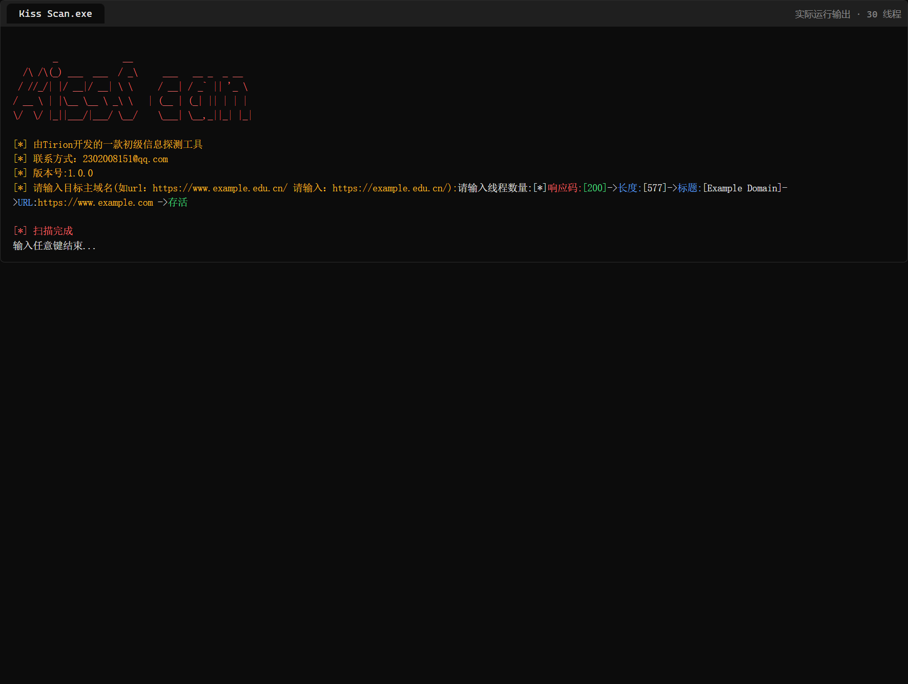
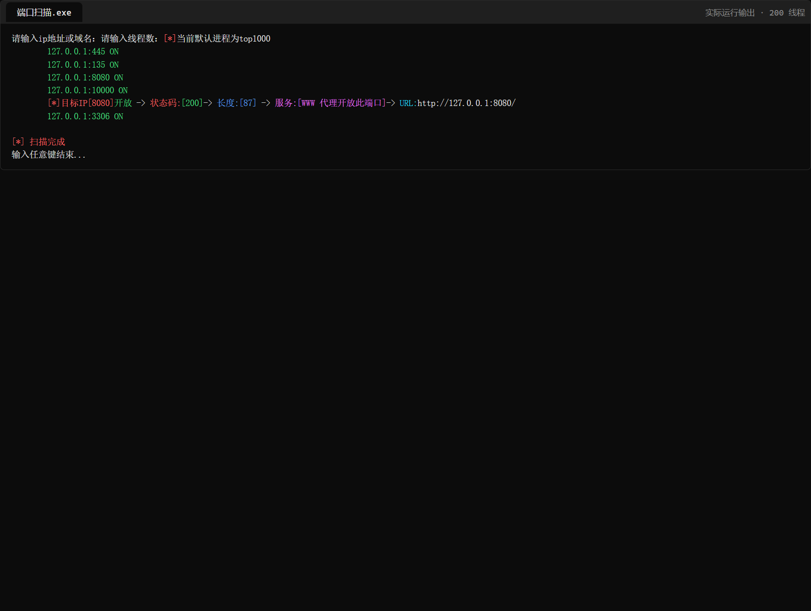

# Kiss Scan & 端口扫描 · 轻量级信息收集工具集

两款基于 **Python 3** 的轻量级命令行信息收集工具：一个做**子域名爆破**，一个做**端口扫描**。
单文件、无服务端依赖，Windows 下双击 exe 即用（发布版已用 PyInstaller 打包，目标机器无需安装 Python）。

| 工具 | 作用 | 内置数据 | 打包体积 |
| --- | --- | --- | --- |
| **Kiss Scan** | 子域名爆破 + 存活探测 + 标题抓取 + ICP 备案查询 | **1581** 条子域名字典 | 15.5 MB |
| **端口扫描** | top1000 端口扫描 + HTTP 指纹 + 服务名映射 | **774** 条端口→服务说明 | 15.5 MB |

---

## 一、Kiss Scan（子域名爆破）

### 功能

- 输入一个主域名（如 `https://example.com/`），自动用内置 **1581 条**子域名字典逐个拼接探测；
- 多线程并发（线程数运行时指定），带锁去重，避免重复扫描；
- 命中即输出四要素：**响应码 → 响应长度 → 页面标题 → 存活 URL**；
- 附带 **ICP 备案号**查询（调用第三方公开接口）；
- 随机 UA 伪装（Chrome/Edge 153），单请求 5 秒超时，失败静默跳过，不中断整体扫描。

### 运行截图



> 上图是**真实运行输出**：以 `https://example.com/`（IANA 文档保留域）为目标、30 线程，
> 命中 `https://www.example.com` → `[200] → 长度:577 → 标题:[Example Domain] → 存活`。

### 实际输出示例

```text
        _             __
  /\ /\(_) ___  ___  / _\     ___   __ _  _ __
 / //_/| |/ __|/ __| \ \     / __| / _` || '_ \
/ __ \ | |\__ \\__ \ _\ \   | (__ | (_| || | | |
\/  \/ |_||___/|___/ \__/    \___| \__,_||_| |_|

[*] 由Tirion开发的一款初级信息探测工具
[*] 联系方式：2302008151@qq.com
[*] 版本号:1.0.0
[*] 请输入目标主域名(如url：https://www.example.edu.cn/ 请输入：https://example.edu.cn/):https://example.com/
请输入线程数量:30
[*]响应码:[200]->长度:[577]->标题:[Example Domain]->URL:https://www.example.com ->存活

[*] 扫描完成
输入任意键结束...
```

### 使用

1. 双击 `Kiss Scan.exe`（或 `python "Kiss Scan.py"`）；
2. 按提示输入**主域名**（注意：要给主域，不要给 `www.` 前缀，例如 `https://example.com/`）；
3. 输入线程数（建议 20～50，过高容易触发目标限流）；
4. 等待输出 `[*] 扫描完成` 后按任意键退出。

---

## 二、端口扫描（top1000 + HTTP 指纹）

### 功能

- 输入 IP 或域名，扫描内置的 **top1000 常用端口**；
- `socket` 全连接探测，多线程并发，开放端口即时打印 `IP:PORT ON`；
- 对**开放端口再发一次 HTTP 请求**做指纹：输出 `状态码 / 响应长度 / URL`；
- 内置 **774 条端口→服务说明**字典，把端口翻译成人话（例如 `8080 → WWW 代理开放此端口`）；
- 关闭端口/超时静默跳过，不刷屏。

### 运行截图



> 上图是**真实运行输出**：目标是本机 `127.0.0.1`、200 线程，
> 扫出 `445 / 135 / 8080 / 10000 / 3306` 开放，并对 `8080` 完成了 HTTP 指纹（`[200] / 长度 87 / 服务:WWW 代理开放此端口`）。

### 实际输出示例

```text
请输入ip地址或域名：127.0.0.1
请输入线程数：200
[*]当前默认进程为top1000
	127.0.0.1:445 ON
	127.0.0.1:135 ON
	127.0.0.1:8080 ON
	127.0.0.1:10000 ON
	[*]目标IP[8080]开放 -> 状态码:[200]-> 长度:[87] -> 服务:[WWW 代理开放此端口]->URL:http://127.0.0.1:8080/
	127.0.0.1:3306 ON

[*] 扫描完成
输入任意键结束...
```

### 使用

1. 双击 `端口扫描.exe`（或 `python 端口扫描.py`）；
2. 输入目标 IP 或域名，输入线程数（内网建议 200～500，公网建议 ≤100 以免被判定为扫描）；
3. 等待 `[*] 扫描完成`，按任意键退出。

---

## 从源码运行

```bash
pip install requests
python "Kiss Scan.py"
python "端口扫描.py"
```

依赖只有 `requests`（`urllib3` 随附）。

## 自行打包 exe

仓库内附两个 PyInstaller spec，直接复用即可：

```bash
pip install pyinstaller
pyinstaller "Kiss Scan.spec"
pyinstaller "端口扫描.spec"
```

产物在 `dist/` 下。spec 中 `icon=['1.jpg']` 指向自定义图标，换成你自己的图片即可。

## 说明与已知限制

- 两个工具都是**交互式**的（运行后按提示输入），没有命令行参数，不支持管道批处理；
- **Kiss Scan 的备案查询**依赖第三方接口（`huodaidaohang.cn`），接口异常时会打印「备案号查询出错」，**不影响子域名爆破结果**；
- **代理/全局 DNS 劫持会污染爆破结果**：若本机开启了 fake-IP 模式的代理，所有子域名都会解析到同一个假 IP，命中判断随之失真——这是环境问题，不是工具问题，建议直连或把目标加入代理白名单；
- 端口扫描的**服务名来自内置字典**，只按端口号匹配，可能与真实服务不符（例如 8080 被标为 `WWW 代理开放此端口`），请以实际指纹为准；
- 端口扫描固定为 top1000，暂不支持自定义端口段。

## 免责声明

本工具仅用于**已获授权**的渗透测试、资产自查与教学研究。
使用者需自行确保对目标拥有合法授权；因使用本工具造成的任何后果由使用者承担。

## License

[MIT](LICENSE)

## Author

**Tirion** · 2302008151@qq.com

---

## English (brief)

Two lightweight Python 3 CLI tools for information gathering:

- **Kiss Scan** — subdomain brute-force with a built-in 1581-entry wordlist, multithreaded probing, and it reports
  `status code → body length → page title → live URL`, plus a Chinese ICP filing lookup.
- **Port Scan (端口扫描)** — top-1000 TCP port scan, multithreaded, with an HTTP fingerprint pass on open ports
  (`status / length / URL`) and a built-in 774-entry port→service dictionary.

Both are interactive (prompt-driven), need only `requests`, and ship as standalone Windows executables built with PyInstaller.

**Disclaimer:** for authorized testing only.
